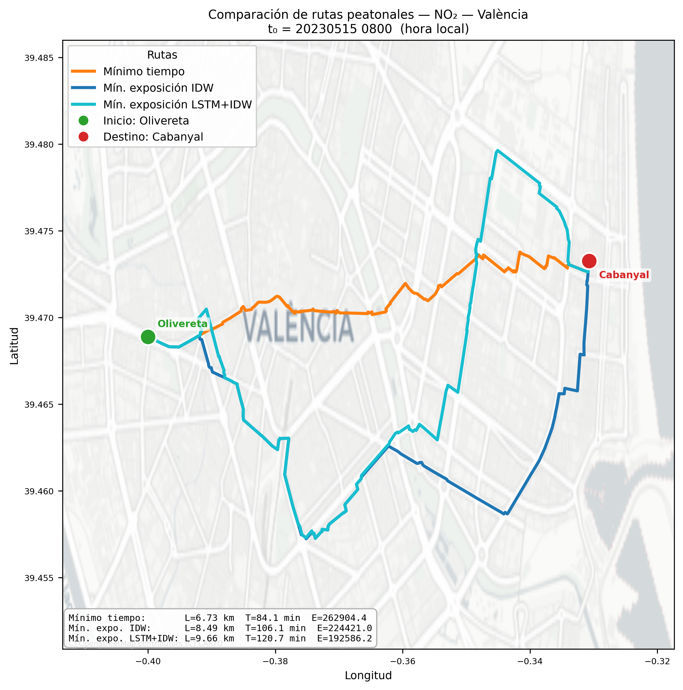

# Rutas peatonales de mínima exposición a NO₂

**Planificación de rutas peatonales de mínima exposición a contaminación atmosférica mediante aprendizaje profundo — València.**


[](https://github.com/carlosgarcia100691-oss/tfg-rutas-peatonales-no2/actions/workflows/tests.yml)

Pipeline reproducible que calcula, sobre la red peatonal de València, rutas que minimizan
la **dosis acumulada de dióxido de nitrógeno (NO₂)** frente a la ruta de menor tiempo.
Combina interpolación espacial, predicción temporal con redes LSTM, generación de
escenarios de estrés con una GAN y caminos mínimos sobre grafos.

<p align="center">
  
</p>

## Contexto académico

Software desarrollado para el **Trabajo Fin de Grado** del **Grado en Matemáticas** de la
**Universitat de València** (curso 2025/2026).

- **Autor:** Carlos Cañas García-Moreno
- **Tutora:** María Roser Benavent García
- **Memoria completa:** [`docs/memoria_TFG.pdf`](docs/memoria_TFG.pdf)

## Planteamiento

Dada una ruta discreta γ parametrizada por el tiempo, la exposición acumulada se define como

```
E(γ) ≈ Σₖ c_NO2(xₖ, tₖ) · Δtₖ
```

donde `c_NO2(x, t)` es la concentración interpolada en el punto `xₖ` en el instante de paso
`tₖ`. Asignando a cada arista de la red viaria su coste de exposición, la ruta de mínima
exposición se reduce a un **problema de caminos mínimos** en un grafo ponderado (Dijkstra).

| Componente | Técnica | Papel en el pipeline |
|---|---|---|
| Preprocesamiento | Limpieza, análisis de *missingness*, imputación (ffill/bfill → interpolación lineal → `IterativeImputer`), escalado z-score | Series horarias y de 10 min de 11 estaciones (2022–2024) |
| Campo espacial | Interpolación **IDW** con distancia haversine (`BallTree`) | Concentración continua de NO₂ sobre la ciudad |
| Predicción temporal | **LSTM** univariante por estación (ventana de 24 h, horizonte de 60 min) | Evolución del campo durante el trayecto |
| Escenarios de estrés | **GAN** sobre vectores de NO₂ multiestación | Episodios sintéticos de contaminación más severa |
| Rutas | **Dijkstra** sobre la red peatonal de OpenStreetMap (OSMnx) | Rutas de mínimo tiempo, mínima exposición estática (IDW) y dinámica (LSTM+IDW) |

## Resultados

Se evaluaron **10 pares origen–destino** en distintas fechas y horas, comparando tres
estrategias: mínimo tiempo, mínima exposición con campo IDW estático y mínima exposición
dinámica con predicción LSTM.

| Escenario | IDW mejora a mínimo tiempo | LSTM mejora a mínimo tiempo | LSTM mejora a IDW estático |
|---|---|---|---|
| Condiciones observadas | 10/10 casos | 8/10 casos | 0/10 casos |
| Escenario de estrés GAN | 10/10 casos | 10/10 casos | **10/10 casos** |

- Optimizar por exposición **reduce sistemáticamente la dosis acumulada de NO₂** frente a
  la ruta más rápida, con un incremento moderado del tiempo de viaje.
- La **predicción temporal con LSTM** aporta una ventaja adicional en episodios de
  contaminación severa y dinámica; en condiciones estables, el campo estático es suficiente.

Las tablas completas, con longitudes, tiempos y exposiciones medias, se recogen en el
capítulo 7 de la [memoria](docs/memoria_TFG.pdf). Los resultados por caso (GeoJSON de cada
ruta, métricas, figuras y mapas interactivos) están en [`resultados/`](resultados/).

### Visualizaciones interactivas

- [`resultados/animaciones/ruta_lstm_gan.html`](resultados/animaciones/ruta_lstm_gan.html):
  evolución del campo de NO₂ durante 60 minutos y avance del peatón por la ruta.
- `resultados/batch_*/case_XX/mapa_*.html`: mapa Folium de las tres rutas de cada caso.

Descarga el archivo HTML y ábrelo en el navegador.

## Estructura del repositorio

```
tfg-rutas-peatonales-no2/
├── scripts/
│   ├── p1_build_dataset.py            # JSON de calidad del aire → CSV normalizados
│   ├── p2_lstm_predict.py             # Predicción LSTM por estación (10 min)
│   ├── p3_snapshot_observed.py        # Campo observado en el instante t0
│   ├── p4_compute_routes.py           # IDW + Dijkstra → 3 rutas y métricas
│   ├── p5_figura_tfg.py               # Figura PNG + mapa HTML interactivo
│   ├── p6_batch_no_gan.py             # Batch de 10 casos sin GAN
│   ├── p6_make_gan_scenarios.py       # Escenarios GAN estáticos
│   ├── p6_gan_temporal.py             # Escenario GAN temporal sobre la predicción LSTM
│   ├── p7_batch_gan.py                # Batch de 10 casos con GAN
│   ├── 4a_make_gan_dataset.py         # Dataset de entrenamiento de la GAN
│   ├── 4b_train_gan_no2_vectors_tf.py # Entrenamiento de la GAN (TensorFlow)
│   ├── cargar_*_mejorado.py           # Carga de datos de aire y meteorología
│   ├── imputacion_pipeline_all.py     # Imputación de valores faltantes
│   ├── validacion_imputacion.py       # Validación de métodos de imputación
│   ├── eda_completo.py                # Análisis exploratorio
│   └── animate_lstm_gan_route.py      # Animación HTML LSTM + GAN
├── config/tfg_params.yaml             # Parámetros del pipeline
├── models/                            # Generador GAN y LSTM de referencia
├── resultados/                        # Resultados de los experimentos
├── tests/test_pipeline.py             # Tests con datos sintéticos
├── docs/memoria_TFG.pdf               # Memoria del TFG
├── datos/README.md                    # Origen y organización de los datos
├── run_pipeline.ps1                   # Ejecución completa del pipeline
└── requirements.txt
```

## Instalación

Requiere **Python 3.10 o 3.11** (TensorFlow < 2.16).

```bash
git clone https://github.com/carlosgarcia100691-oss/tfg-rutas-peatonales-no2.git
cd tfg-rutas-peatonales-no2
python -m venv .venv
.venv\Scripts\activate          # Windows  (Linux/macOS: source .venv/bin/activate)
pip install -r requirements.txt
```

## Uso

Los datos de calidad del aire no se incluyen en el repositorio (ver [`datos/README.md`](datos/README.md)).
Una vez colocados en `datos/aire/`, el pipeline completo se ejecuta con:

```powershell
.\run_pipeline.ps1
```

O etapa a etapa, por ejemplo para un par origen–destino:

```bash
PD=resultados/pipeline

python scripts/p1_build_dataset.py --aire-json-60min datos/aire/60min \
    --aire-json-10min datos/aire/10min --outdir $PD

python scripts/p2_lstm_predict.py --air-csv $PD/aire_10min_raw.csv \
    --stations-csv $PD/stations_all.csv --var NO2 --time "2023-05-15 08:00" \
    --lookback 144 --horizon-steps 6 --allow-fallback \
    --out $PD/lstm_preds_NO2_20230515_0800.csv

python scripts/p3_snapshot_observed.py --air-csv $PD/aire_60min_raw.csv \
    --stations-csv $PD/stations_all.csv --var NO2 --time "2023-05-15 08:00" \
    --out $PD/snapshot_obs_NO2_20230515_0800.csv

python scripts/p4_compute_routes.py \
    --snapshot-csv $PD/snapshot_obs_NO2_20230515_0800.csv \
    --lstm-csv $PD/lstm_preds_NO2_20230515_0800.csv \
    --var NO2 --time "2023-05-15 08:00" \
    --origin 39.4692 -0.4059 --dest 39.4736 -0.3254 \
    --k-idw 5 --p-idw 2.0 --r-idw-km 10 --speed-kmh 4.8 --buffer-km 3.0 \
    --outdir $PD
```

Cada script documenta sus argumentos con `--help`. Los parámetros utilizados están
centralizados en [`config/tfg_params.yaml`](config/tfg_params.yaml).

### Tests

```bash
pip install pytest
python -m pytest tests/ -v
```

Los tests usan datos sintéticos en memoria y no requieren conexión ni los datos originales.

## Parámetros principales

| Parámetro | Valor | Descripción |
|---|---|---|
| `k_idw` | 5 | Vecinos más próximos en IDW |
| `p_idw` | 2.0 | Exponente de ponderación IDW |
| `r_idw_km` | 10 | Radio de búsqueda IDW (km) |
| `speed_kmh` | 4.8 | Velocidad peatonal |
| `lookback` | 144 | Pasos de 10 min de historia para la LSTM (24 h) |
| `horizon_steps` | 6 | Pasos de 10 min predichos (60 min) |
| `stress_factor` | 1.5 | Amplificación del escenario GAN |
| `seed` | 42 | Semilla aleatoria |

## Datos y atribuciones

- **Calidad del aire:** series de las estaciones de València obtenidas en el marco del
  proyecto europeo **CITCOM.AI**.
- **Red viaria:** © colaboradores de [OpenStreetMap](https://www.openstreetmap.org/copyright),
  datos bajo licencia ODbL. Mapas base © CARTO.

## Cómo citar

```bibtex
@bachelorsthesis{canas_2026_rutas_no2,
  title  = {Planificación de rutas peatonales de mínima exposición a contaminación
            atmosférica mediante aprendizaje profundo},
  author = {Cañas García-Moreno, Carlos},
  school = {Universitat de València},
  type   = {Trabajo Fin de Grado},
  note   = {Grado en Matemáticas. Tutora: María Roser Benavent García},
  year   = {2026}
}
```

## Licencia

El código se distribuye bajo licencia **MIT** (ver [`LICENSE`](LICENSE)). La memoria del TFG
(`docs/memoria_TFG.pdf`) se incluye con fines de consulta y mantiene los derechos de su autor.
